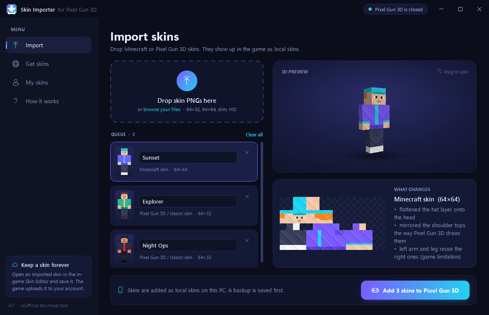
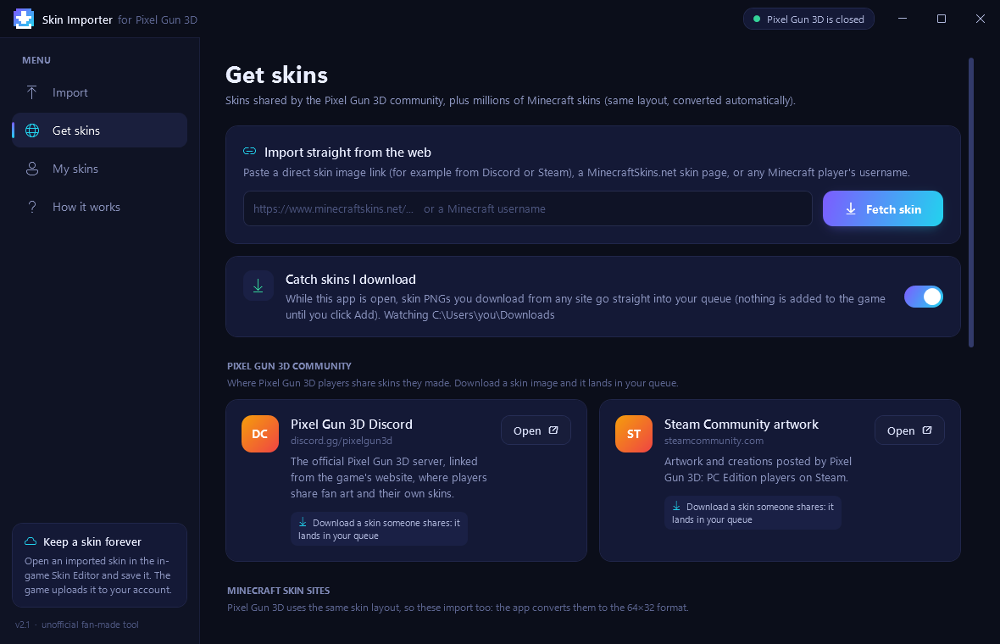
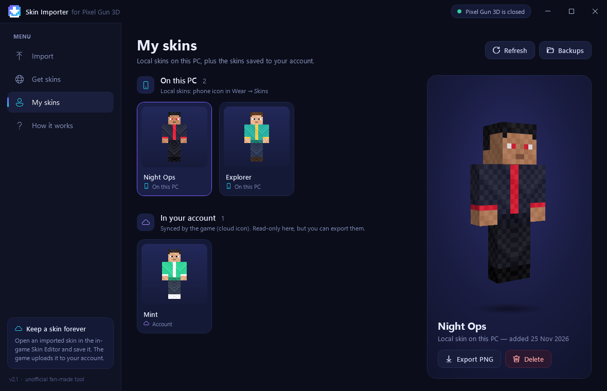

# Skin Importer for Pixel Gun 3D

A free Windows app that puts custom skins into **Pixel Gun 3D: PC Edition** (Steam): your own PNGs, skins shared by the Pixel Gun 3D community, and Minecraft skins (converted automatically).

## Download

**[PG3D Skin Importer.exe](dist/PG3D%20Skin%20Importer.exe)**: Windows 10/11, about 140 KB, nothing to install. Open the link and use the download button (*Download raw file*).

Windows SmartScreen may warn that the app comes from an unknown publisher, because it isn't code-signed. Click **More info → Run anyway**.

## How it works

1. Close Pixel Gun 3D (the game rewrites its saved skins when it exits).
2. Drop skin PNGs into the app, or fetch them on **Get skins**, then click **Add to Pixel Gun 3D**.
3. Start the game and open **Wear → Skins**. Imported skins have a phone icon: they are stored on this PC.
4. To keep a skin in your account, open it in the in-game Skin Editor and save it. The game uploads it and it gets a cloud icon.

## Features

- **3D preview** you can spin, plus the 64×32 texture and a list of every change the converter makes.
- **Minecraft skins convert automatically.** 64×64, slim (3 px arms) and HD skins become the 64×32 Pixel Gun 3D layout: the 2nd layer is flattened, slim arms are widened and the shoulder tops are mirrored the way Pixel Gun 3D draws them.
- **Get skins.** Links to the Pixel Gun 3D community (official Discord, Steam community artwork) and to big Minecraft skin sites. Import by Minecraft username, MinecraftSkins.net link or any direct image link; skins you download are caught from your Downloads folder automatically.
- **My skins.** Your local skins and the skins in your account, with a 3D preview, PNG export and delete.
- **Careful by design.** Only the game's local-skin list is changed, never while the game is running, and a `.reg` backup is saved before every change (double-click it to undo).

| Get skins | My skins |
|---|---|
|  |  |

## Under the hood

Pixel Gun 3D still loads *local skins* from two Unity PlayerPrefs values under `HKCU\Software\Pixel Gun Team\Pixel Gun 3D`:

| Value | Contents |
|---|---|
| `User Skins_h1196497400` | `{"<id>": "<base64 64×32 PNG>", ...}` |
| `User Name Skins_h1318731231` | `{"<id>": "<name>", ...}` |

Both are UTF-8 JSON followed by a NUL byte, stored as `REG_BINARY`; ids are .NET `DateTime` ticks. Skins synced to your account live on the game's servers and are only read here. Settings and backups are kept in `%LOCALAPPDATA%\PG3D Skin Importer`.

## Build from source

The whole app is one PowerShell + WPF script, [`PG3D-Skin-Importer.ps1`](PG3D-Skin-Importer.ps1), with nothing to install.

- Run it directly: double-click `PG3D Skin Importer.cmd`.
- Build the `.exe`: `powershell -NoProfile -ExecutionPolicy Bypass -File Build-Exe.ps1` (add `-Install` for Desktop and Start menu shortcuts). It uses the C# compiler that ships with Windows.

## Credits

The local-skin registry values were first documented by [mof-22/PG3D_skin_importer](https://github.com/mof-22/PG3D_skin_importer) and [YeetDisDude/skinimporter](https://github.com/YeetDisDude/skinimporter).

## Disclaimer

Unofficial, fan-made tool. Not affiliated with or endorsed by the developers of Pixel Gun 3D. Use at your own risk.
